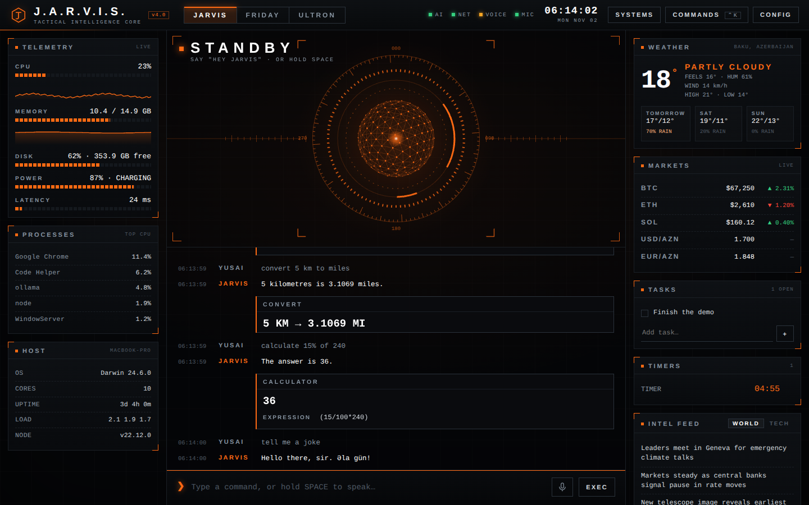

<div align="center">
  
# J.A.R.V.I.S. — Tactical Intelligence Core

**A private AI command console that runs on your own machine.**
Local LLM · voice in and out · live intel · real system telemetry · full Mac control.
No cloud accounts. No API keys.

[](https://github.com/Gityus13/jarvis/actions/workflows/ci.yml)


 



<sub>Screenshot uses sample data for the weather, markets, headlines and telemetry panels.</sub>

</div>

---

## Features

* 🎙 **Voice** — say *"Hey Jarvis"* or hold `SPACE`. Neural voice (Kokoro) or your system voice. It never listens while it speaks.
* 🧠 **Local AI** — any [Ollama](https://ollama.com) model. Your conversations never leave your computer.
* 📡 **Live intel** — weather, news, crypto + FX, Wikipedia, dictionary, translation — all free, no keys.
* ⏱ **Organiser** — timers, reminders, alarms (spoken alerts), tasks, notes, daily briefing.
* 🖥 **Real telemetry** — CPU, memory, disk, battery, latency, top processes.
* 🍎 **Mac control** — open/close apps, type, click, screenshots, volume, windows, Spotify/Music, calendar, Shortcuts.
* 🛠 **Self-diagnosing** — a `SYSTEMS` panel (and `npm run doctor`) shows what works and the exact fix for what doesn't.
* 🔌 **Extensible** — drop a `.js` file in `plugins/` to add your own commands.

## Quick start

```bash
git clone https://github.com/Gityus13/jarvis.git
cd jarvis
./setup.sh          # installs, creates .env, checks Ollama, offers to download a model
npm start
```

Open **http://localhost:3000** in **Chrome** (or Edge) and press any key on the boot screen.

<details>
<summary>Manual install</summary>

```bash
# 1. AI engine (once)
brew install ollama          # Linux: curl -fsSL https://ollama.com/install.sh | sh
ollama serve                 # keep running (separate terminal)
ollama pull llama3.2         # or any chat model

# 2. JARVIS
cp .env.example .env         # set USER_NAME, OLLAMA_MODEL …
npm install
npm start
```
</details>

### Requirements

| | |
|---|---|
| **Node.js** | 18 or newer (22 LTS recommended) |
| **Ollama** | with at least one chat model (`llama3.2`, `qwen2.5`, `mistral`, `gpt-oss`, …) |
| **Browser** | Chrome or Edge on `http://localhost:3000` (voice input needs their speech recognition; Safari/Firefox are unreliable) |
| **Internet** | for weather/news/markets/translate and Chrome's speech recognition. Everything else works offline |

### Platform support

| | macOS | Linux | Windows |
|---|:-:|:-:|:-:|
| Console, AI, voice, intel, timers, tasks, notes, telemetry | ✅ | ✅ | ✅ |
| Open/close apps, typing, clicks, screenshots, volume, lock | ✅ | ✅ | partial |
| Calendar, iMessage, Shortcuts, window snapping, Spotify/Music control | ✅ | – | – |

On macOS run `bash setup-permissions.sh` once (Accessibility, Automation, Calendar).

## The console

| Area | Shows (all real data) |
|---|---|
| **Core** (centre) | Animated core: standby · listening (your mic level) · processing · responding |
| **Telemetry** (left) | CPU / memory / disk / battery / latency with sparklines, top processes, host |
| **Intel** (right) | Weather, markets, headlines (world / tech), tasks, live timers, notes |
| **Feed** (centre) | Conversation, executed actions, result cards (click items to run them) |
| **SYSTEMS** | Self-diagnostics with fixes |
| **COMMANDS** `Ctrl+K` | Searchable index of everything JARVIS can do |

Three operating modes — **JARVIS** (composed, dry), **FRIDAY** (fast, direct), **ULTRON** (cold, clinical) — each with its own colour, voice and tone. Switch in the top bar or say *"switch to Friday"*.

## Voice

* **"Hey Jarvis"** (also *Friday*, *Ultron*) — fuzzy matched, so *"Travis"* / *"jar vis"* work. Say the command in the same breath (*"Jarvis, what's the weather"*) or wait for the acknowledgement.
* **Hold `SPACE`** (or the mic button), speak, release. It waits for your final words.
* JARVIS never listens while it is speaking.
* **The first sound of a session needs one key press or click** — that is a browser rule, and it is what the boot screen's *PRESS ANY KEY* is for. If the neural voice is still starting, the greeting waits for it (up to 9 s).
* **Switching tabs is safe.** The mic is released while the tab is hidden and resumes when you return. If it ever shows `MIC BLOCKED`, click the **MIC** indicator at the top to retry — no reload needed.

**Voice output**, in order of preference: **Kokoro** neural voice → **ElevenLabs** (if a key is set) → your system voice.

### Kokoro neural voice (free, local)

```bash
npm i kokoro-js      # already an optional dependency: `npm install` normally pulls it in
npm start            # first run downloads ~90 MB into data/models, then it's cached
```

Progress is shown in `SYSTEMS` and the terminal. Short lines (acknowledgements, "Done, sir.") are cached and pre-generated in the background, so they play instantly. If anything goes wrong JARVIS keeps using your system voice and tells you *why*:

```bash
npm run kokoro-test  # loads the model, speaks a test line, prints the exact error + fix if it fails
```

| Problem | Fix |
|---|---|
| Stuck on "downloading" / can't reach Hugging Face | Check VPN/internet, or set `HF_ENDPOINT=https://hf-mirror.com` in `.env`. It retries automatically |
| "ONNX runtime failed to load" | Use Node 22 LTS (`brew install node@22`), then `rm -rf node_modules && npm install` |
| Don't want it | `KOKORO=off` in `.env` |

## What you can say

| | |
|---|---|
| **Briefing** | "daily briefing" · "good morning" — time, weather, tasks, calendar, top headline |
| **Weather** | "weather" · "weather in Tokyo" · "will it rain tomorrow" |
| **News** | "news" · "tech news" · "business news" · "science news" · "sport news" |
| **Markets** | "bitcoin price" · "crypto" · "convert 100 usd to eur" · "50 pounds in yen" |
| **Knowledge** | "who is Nikola Tesla" · "define ephemeral" · "time in Tokyo" |
| **Translate** | "translate good morning to Spanish" · "how do you say thank you in Turkish" |
| **Timers** | "timer for 10 minutes" · "remind me in 20 minutes to call mom" · "remind me at 5pm to …" · "alarm for 7:30" · "focus session" |
| **Tasks / notes** | "add task buy milk" · "my tasks" · "complete task 2" · "take a note: …" · "show my notes" |
| **System** | "system status" · "what's using my CPU" · "disk space" · "battery" · "wifi" · "my IP address" |
| **Music** | "play" · "pause" · "next song" · "what's playing" (Spotify / Apple Music) |
| **Files** | "find file resume.pdf" (click a result to open) · "create a folder called Projects" |
| **Clipboard AI** | "summarize my clipboard" · "fix my clipboard" · "translate my clipboard to Turkish" |
| **Utilities** | "calculate 15% of 240" · "convert 5 km to miles" · "generate a password" · "flip a coin" · "roll a d20" |
| **Mac control** | "open Spotify" · "close Chrome" · "screenshot" · "volume up" · "lock screen" · "snap Safari to the left" · "type …" · "press command shift 4" |
| **Anything else** | Goes to your local AI — which can also call every skill above on its own |

Timers, reminders and alarms keep running if you close the page and speak an alert when you return.

## Free services used (no keys, no accounts)

[Open-Meteo](https://open-meteo.com) (weather, geocoding) · [ipwho.is](https://ipwho.is) (location, IP) · [CoinGecko](https://www.coingecko.com) (crypto) · [open.er-api.com](https://open.er-api.com) (FX) · BBC RSS + [Hacker News](https://news.ycombinator.com) (headlines) · [Wikipedia](https://www.wikipedia.org) · [dictionaryapi.dev](https://dictionaryapi.dev) · [MyMemory](https://mymemory.translated.net) (translation).
Everything degrades gracefully offline — the console says what is unavailable instead of failing silently.

## Configuration

Copy `.env.example` to `.env`. Everything is optional.

| Variable | Default | |
|---|---|---|
| `OLLAMA_MODEL` | `llama3.2` | Any model from `ollama list` (cloud models need `ollama signin`) |
| `OLLAMA_URL` | `http://localhost:11434` | |
| `USER_NAME` | *(empty → "sir")* | What JARVIS calls you |
| `HOME_CITY` | *(detected from IP)* | Weather + briefing. Or say *"set my city to Paris"* |
| `HOME_CURRENCY` / `UNITS` | `USD` / `metric` | Markets panel · `metric` or `imperial` |
| `KOKORO`, `KOKORO_DTYPE`, `KOKORO_VOICE_*`, `HF_ENDPOINT` | | Neural voice settings |
| `ELEVENLABS_API_KEY`, `ELEVENLABS_VOICE_*` | | Optional premium voice |
| `JARVIS_VOICE`, `FRIDAY_VOICE`, `ULTRON_VOICE` | Daniel / Moira / Alex | Preferred system voices |
| `PORT`, `HOST`, `ALLOWED_HOSTS` | `3000`, `127.0.0.1` | Network (see Security) |

## Commands

| | |
|---|---|
| `npm start` | Run JARVIS |
| `npm run dev` | Run with auto-reload |
| `npm run doctor` | Self-check in the terminal — paste it into bug reports |
| `npm run kokoro-test` | Test the neural voice end to end |
| `npm test` | 140+ tests: skills, router, Mac control, Kokoro, real-server e2e, UI + voice engine |

## Troubleshooting

Open **SYSTEMS** in the top bar (or run `npm run doctor`) — it lists what is online and the fix for anything that isn't.

<details><summary><b>The mic doesn't hear me / wake word never triggers</b></summary>

Use Chrome or Edge at `http://localhost:3000` (not the IP address, not Safari) and allow the microphone. While waiting for the wake word the centre of the console shows `HEARD: "…"` — if it never changes, the mic isn't reaching the browser. Chrome's speech recognition needs internet. Or just hold `SPACE`.
</details>

<details><summary><b>I'm using Safari</b></summary>

JARVIS works, but Safari is the strictest browser for voice: use **Chrome or Edge** for the best results (`SYSTEMS` flags this). In Safari, allow the microphone for the site and turn on **Dictation** (System Settings → Keyboard), and press a key on the boot screen so it may play audio.
</details>

<details><summary><b>The neural voice (Kokoro) isn't used</b></summary>

Open `SYSTEMS` — it shows download progress or the exact error. Until the model is ready JARVIS uses your system voice, then switches by itself. `npm run kokoro-test` gives the full diagnosis. If audio is blocked by the browser you'll see *"click anywhere once to enable the neural voice"*.
</details>

<details><summary><b>Typing / clicking / key presses do nothing (macOS)</b></summary>

Grant **Accessibility** to the app that runs `node` (Terminal, iTerm or VS Code): System Settings → Privacy & Security → Accessibility. `SYSTEMS` shows this check. If `robotjs` failed to install: `xcode-select --install`, then `npm install`.
</details>

<details><summary><b>"Model not found" / AI doesn't answer</b></summary>

`ollama serve` must be running, and `OLLAMA_MODEL` in `.env` must match `ollama list`. Cloud models (names ending in `-cloud`) need a one-time `ollama signin`.
</details>

<details><summary><b>Calendar says access denied</b></summary>

System Settings → Privacy & Security → Calendars (and Automation) → allow your `node` binary (`which node`).
</details>

<details><summary><b>Port 3000 is in use</b></summary>

Set `PORT=3001` in `.env`.
</details>

<details><summary><b>Use it from my phone / another computer</b></summary>

Only on a trusted LAN: `HOST=0.0.0.0` and `ALLOWED_HOSTS=<this-computer's-ip>` in `.env`. **Never expose it to the internet.**
</details>

## Security

JARVIS can type, click and run apps on your computer, so it is locked down: it listens on `127.0.0.1` only, rejects any WebSocket/API request whose `Origin`/`Host` isn't localhost (a random website can't drive your Mac), never builds shell commands from text, limits file actions to your home folder, and never speaks or stores generated passwords. See [SECURITY.md](SECURITY.md).

## Plugins

```js
// plugins/coffee.js
module.exports = {
  name: "coffee",
  matches: (text) => /\bcoffee\b/i.test(text),
  execute: async () => "Brewing. Estimated four minutes.",
};
```

Drop it in `plugins/`, restart. See [plugins/README.md](plugins/README.md).

## Project layout

```
server.js                 HTTP + WebSocket server and the request flow
src/skills/               web.js (online skills) · local.js (offline skills) · index.js (router, briefing)
src/command-router.js     fast pattern routing for built-in commands (no AI round-trip)
src/mac-control.js        macOS / keyboard / mouse control — execFile only, no shell strings
src/kokoro.js · tts.js    neural voice (progress, stall detection, warm-up) · ElevenLabs
src/telemetry.js          real CPU / memory / disk / battery / process sampling
src/diagnostics.js        the self-checks behind SYSTEMS and `npm run doctor`
src/personalities.js      JARVIS / FRIDAY / ULTRON
src/store.js              tasks · notes · reminders (data/jarvis-data.json)
public/                   console UI — core.js (visual) · voice.js (speech) · app.js (UI) · no build step
plugins/                  your extensions
test/                     node:test suites (no internet / Ollama / mic needed)
```

## Contributing

PRs welcome — see [CONTRIBUTING.md](CONTRIBUTING.md). Run `npm test` first.

## Credits & disclaimer

Built on [Ollama](https://ollama.com), [Kokoro-82M](https://huggingface.co/hexgrad/Kokoro-82M) via [kokoro-js](https://github.com/hexgrad/kokoro), [robotjs](https://github.com/jitsi/robotjs), [Express](https://expressjs.com) and [ws](https://github.com/websockets/ws).

*J.A.R.V.I.S.* is a fictional character from Marvel's Iron Man. This is an independent fan project and is not affiliated with or endorsed by Marvel or Disney.

[MIT](LICENSE) © Gityus13

---

<div align="center">
  <a href="https://gityus13.dev">
    
  </a>
</div>
